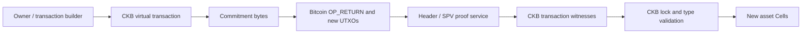

# RGB++ read-only asset inspector

Current live asset lookup supports both network pairs and arbitrary input. The initial fixture walkthrough below is now an explicit advanced regression tool. See [Live Labs](live-labs.md).

Open `/rgbpp` in the portal. This tool compares a public Bitcoin Testnet3 / CKB Testnet sample, recomputes its virtual transaction commitment and separately observes current chain state. It does not construct, sign or broadcast transfers.

## Evidence boundaries

The result has three separate layers:

1. **Offline linkage:** check lock identity, decode binding, compare a selected Bitcoin seal with a selected historical Cell, verify the unsigned Bitcoin input link, check virtual output indexes and recompute the snapshot commitment.
2. **Public API/node observations:** check network genesis, deployment type hash, historical Cell contents, current UTXO spend state and `get_live_cell` response. Record tips and canonical containing blocks independently.
3. **Proof:** always **not verified** in this implementation. No Bitcoin header/SPV verifier, lock execution or signature verification is performed.

Neither a matching commitment, an explorer entry nor two transaction hashes implies cross-chain completion. Full typed-input coverage, token conservation and ownership authorization remain outside these checks. A committed historical Cell can coexist with an unknown current live status.

## Selected versions

Pins: [`portal/src/features/rgbpp/pins.json`](../portal/src/features/rgbpp/pins.json).

| Source | Revision | Use |
| --- | --- | --- |
| `ckb-devrel/ccc`, branch `rgbpp-sdk` | `1016ee901cef3b1aa5d4e25ae736b109c6f2717b` | Binding/commitment encoding reference, network constants and confirmation threshold |
| `RGBPlusPlus/RGBPlusPlus-design` | `5ebbf37d2dc8bd36729ba62392b2f6379b933538` | `docs/lockscript-design-prd-en.md` |
| `RGBPlusPlus/rgbpp` | `4abd216dbd5d25b8f59e843de39643f9b7513f9d` | Script source reference; not rebuilt or VM-verified in this lab |
| `RGBPlusPlus/rgbpp-sdk` | `ee21eb9735c1adeb277e3a02b7f6c2f6fd1d0556` | Public historical fixture and expected unsigned transaction snapshot |
| `RGBPlusPlus/ckb-bitcoin-spv-service` | `e9aa85a3e6ae3e5ac122a68c2fe4fb6d1ed69450` | Proof API documentation; no service/verifier run |

The handbook's CCC branch was accessible when checked on 15 October 2026. No migration to another SDK is claimed. Its source package declares `@ckb-ccc/rgbpp` 1.0.0 with workspace dependencies. The portal does **not** install that branch package: a small read-only port uses existing pinned `@ckb-ccc/core` 1.19.1 serialization and Web Crypto SHA-256. The official snapshot's expected commitment checks compatibility for this sample, not every SDK method.

## Data and actors



The builder prepares Cell state transitions and commitment bytes. Bitcoin records the seal consumption and OP_RETURN commitment; CKB records asset state and binding lock args. A compatible workflow supplies Bitcoin transaction/proof material to CKB validation, referencing the appropriate light-client state. This inspector checks selected data relationships and queries public services; it does not execute that validation workflow.

| Data | Location / encoding | Inspector handling |
| --- | --- | --- |
| Bitcoin seal | Display txid plus uint32 vout | Compared with decoded Cell lock args |
| RGB++ binding | `vout:u32LE || reversed(display txid):32 bytes` | Strict 36-byte decoder |
| Virtual commitment | Double SHA-256 of `RGB++`, version u16LE zero, u8 prefix counts, serialized input OutPoints, CellOutputs and u32LE-length-prefixed output data | Recomputed from the complete virtual prefix in the selected snapshot |
| Future output txid | Zero placeholder in the virtual RGB++ lock args | Required by this limited profile; live tx args are not blindly hashed |
| Bitcoin commitment output | One `OP_RETURN PUSH32` | Compared with recomputed bytes in the unsigned snapshot |
| Proof / client state | Workflow witnesses and compatible SPV/light-client data | Not verified |

Only legacy unsigned Bitcoin snapshot decoding and RGB++ Testnet3 virtual outputs are supported. BTC_TIME_lock, leaps, generic signed/SegWit transaction decoding and arbitrary live-transaction commitment reconstruction are unsupported.

## Network and script identity

The profile fixes the network pair and endpoints. Fixture-supplied URLs are not used.

- Bitcoin Testnet3 genesis: `000000000933ea01ad0ee984209779baaec3ced90fa3f408719526f8d77f4943`.
- CKB Testnet genesis: `0x10639e0895502b5688a6be8cf69460d76541bfa4821629d86d62ba0aae3f9606`.
- Bitcoin API: `https://mempool.space/testnet/api`.
- CKB RPC: `https://testnet.ckb.dev`.
- RGB++ lock: `0x61ca7a4796a4eb19ca4f0d065cb9b10ddcf002f10f7cbb810c706cb6bb5c3248`, hash type `type`.
- Deployment: `0xf1de59e973b85791ec32debbba08dff80c63197e895eb95d67fc1e9f6b413e00:0`.

The node's deployment transaction must be committed and its output type-script hash must equal the configured lock code hash. This is not a comparison against a locally rebuilt binary and does not verify the deployment's SPV/config dependencies.

The pinned SPV service documents `getTxProof(txid, tx-index, confirmations)`. No compatible running endpoint or local verifier input set was configured. Retrieving bytes from that API alone would not justify a verified label. The runtime proof boundary is intentionally explicit.

## Reproduce

From `portal/`, with Node and dependencies installed:

```powershell
npm ci
npm run rgbpp:verify-source
npm run rgbpp:evidence
npm run rgbpp:evidence -- --live
npm test
npm run build
npm run preview -- --host 127.0.0.1 --port 4190
```

`rgbpp:verify-source` fetches immutable upstream fixture files into memory, parses only literal data, compares the public projection and records source SHA-256 hashes. It does not execute upstream TypeScript or retain account objects. The fixture's ISC notice is retained in `src/features/rgbpp/UPSTREAM-LICENSE.txt`.

`rgbpp:evidence` runs offline checks and deliberate negative fixtures. `--live` additionally writes dated raw public API/node observations. Offline runs do not refresh an existing live capture; read each file's date and layer. Public API access requires network connectivity; there are no access tokens in the configuration.

Browser tests:

```powershell
# Set this on Windows when using installed Edge; omit it for installed Playwright Chromium.
$env:PLAYWRIGHT_CHANNEL = 'msedge'
npm run test:e2e:rgbpp
```

With preview running at port 4190, `node scripts/rgbpp-ui-check.mjs` checks real browser observations, receipt export and the Testnet console and writes screenshots. It defaults to installed Edge. The ordinary browser tests are separate from this live check; the API-outage test uses mocked HTTP responses.

## State, failures and refresh

Bitcoin and CKB are reported independently. Requests have a 12-second default deadline, a 1 MiB response cap and a 45-second total observation deadline. There are no automatic retries. API/HTTP/schema failures yield **unknown**, not asset nonexistence. Editing a fixture or refreshing clears old observations; cancel and unmount abort active requests.

Bitcoin's six-confirmation threshold comes from the pinned CCC `DEFAULT_CONFIRMATIONS` configuration and is used only as an observational threshold. A changed tip yields unknown confirmation assessment; a mismatched canonical block hash yields reorg detection and zero confirmations. CKB committed/canonical observations are not irreversible finality. Tips may advance during sequential requests, and the two chains never form an atomic snapshot in this client. `crossChainComplete` remains false.

The wallet network shown by the shared portal header is separate from this inspector's fixed test-network pair. The inspector has its own Testnet feature-console scope. Logs exclude raw request bodies; public raw receipts are available explicitly in the inspector/export.

## Evidence and references

See [Week 10 report](../README-WEEK-10.md), [verification](evidence/week-10/verification.md), [source provenance](evidence/week-10/fixture-provenance.json), [binding map](evidence/week-10/binding-map.json), [negative cases](evidence/week-10/negative-cases.json) and [dated observations](evidence/week-10/observations.json).

Primary references: [introduction](https://rgbpp.com/docs/introduction), [resource hub](https://rgbpp.com/docs/resources), [light paper](https://talk.nervos.org/t/rgb-protocol-light-paper-translation/7790), [pinned script standard](https://github.com/RGBPlusPlus/RGBPlusPlus-design/blob/5ebbf37d2dc8bd36729ba62392b2f6379b933538/docs/lockscript-design-prd-en.md). Explorers are supplementary displays, not proof verification.
